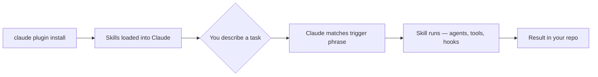

<p align="center">
  
</p>

<h1 align="center">Roxabi-plugins</h1>

<p align="center">
  
  
  
</p>

<p align="center">Open-source Claude Code plugins by <a href="https://github.com/Roxabi">Roxabi</a>. Context engineering tools for teams using Claude Code.</p>

## Why

Every team using Claude Code ends up reinventing the same things: documenting their workflow in `CLAUDE.md`, writing custom slash commands for code review, figuring out how to structure CI setup prompts, syncing docs after a refactor. It works, but it's disposable — none of it is reusable across projects.

Roxabi plugins are the reusable layer on top of Claude Code. Each plugin ships opinionated, battle-tested skills and agents for a specific domain. Install what you need, skip what you don't, and get consistent AI-assisted workflows across every project without starting from scratch.

## Quick Start

```bash
# Claude Code: add the marketplace once, then install the retained plugin.
claude plugin marketplace add Roxabi/roxabi-plugins
claude plugin install issue-triage

# Oh My Pi: omp-build is catalogued for OMP only.
omp plugin marketplace add Roxabi/roxabi-plugins
omp plugin install omp-build@roxabi-marketplace
# After a marketplace update lands:
omp plugin marketplace update roxabi-marketplace
omp plugin upgrade omp-build@roxabi-marketplace
```

Restart OMP after updating; do not use `/reload-plugins`.

Then describe the task or invoke the installed command:

```
"triage issue #42"              → issue-triage
"/feature #42"                  → omp-build
```

## How it works

Each plugin is self-contained: it ships **skills** (trigger-phrase workflows), **agents** (specialized sub-processes), and optionally **hooks** (automated guardrails that run on every tool call). Claude Code discovers and loads them automatically on install.



Retained plugins are project-agnostic: they read the project contract at runtime and adapt to its workflow and repository layout.

## Retained plugins

| Plugin | Host | Description |
|--------|------|-------------|
| [issue-triage](plugins/issue-triage/README.md) | Claude Code, OMP | Triage and create GitHub issues with labels and native relations. |
| [omp-build](plugins/omp-build/README.md) | OMP | Feature cycle: frame → issue → worktree → implement → review/fix → land. Epic resumption recognizes confirmed deliveries without resetting stops. Spent review bounds remain disarmed; operator-supervised agent recovery uses a superseding PR. Qualified retained history is admitted. AssertLedger detection requires explicit root configuration, not bundled Kit tooling. Evidence-based review/fix policy starts in isolated shadow; activation remains explicit. |

Retired plugins are retained only under [`archived/`](archived/); they are inert historical source and are not installable from either marketplace catalog.

### Endorsed marketplaces

External plugin marketplaces we endorse. Install them directly — no vendoring needed.

```bash
claude plugin marketplace add <source>
```

| Marketplace | Description | Source |
|-------------|-------------|--------|
| agent-browser | Headless browser automation CLI for AI agents — navigate, click, fill, screenshot, scrape | [vercel-labs/agent-browser](https://github.com/vercel-labs/agent-browser) |
| roxabi-vault | Persistent memory for agents — SQLite+FTS5 knowledge base with 7 vault skills | [Roxabi/roxabi-vault](https://github.com/Roxabi/roxabi-vault) |
| claude-plugins-official | Official Anthropic plugin marketplace — LSPs, integrations, and workflow skills | [anthropics/claude-plugins-official](https://github.com/anthropics/claude-plugins-official) |
| knowledge-work-plugins | Official Anthropic knowledge-work plugins — design, legal, marketing, product-management, sales | [anthropics/knowledge-work-plugins](https://github.com/anthropics/knowledge-work-plugins) |
| anthropic-agent-skills | Official Anthropic agent skills repository | [anthropics/skills](https://github.com/anthropics/skills) |
| context7 | Upstash Context7 MCP server — version-specific documentation lookup from source repos | [upstash/context7](https://github.com/upstash/context7) |
| visual-explainer | Self-contained HTML pages with diagrams, visualizations, data tables, and slide decks | [nicobailon/visual-explainer](https://github.com/nicobailon/visual-explainer) |
| ui-ux-pro-max-skill | UI/UX design intelligence — 67 styles, 96 palettes, 57 font pairings, 25 charts | [nextlevelbuilder/ui-ux-pro-max-skill](https://github.com/nextlevelbuilder/ui-ux-pro-max-skill) |
| roxabi-video-engine | Programmatic video generation — 55 React components, 13 kits, headless MP4 rendering | [Roxabi/roxabi-production](https://github.com/Roxabi/roxabi-production) |
| frontend-slides | Zero-dependency HTML presentations — 12 presets, PPT conversion, Vercel deploy + PDF export | [zarazhangrui/frontend-slides](https://github.com/zarazhangrui/frontend-slides) |
| roxabi-live | Live/ops marketplace (historical host of issue triage; native `issue-triage` now ships here) | [Roxabi/roxabi-live](https://github.com/Roxabi/roxabi-live) |

## Data storage

The retained catalog does not ship a data-producing plugin. User data belongs outside this repository; see [roxabi-vault](https://github.com/Roxabi/roxabi-vault) for vault storage.

## Marketplace architecture

The active catalogs contain `issue-triage` and `omp-build` only. `issue-triage` appears in both catalogs; `omp-build` is OMP-only and is catalogued in [`.omp-plugin/marketplace.json`](.omp-plugin/marketplace.json), never in the Claude Code catalog.

External plugin marketplaces we endorse are tracked in [`.claude-plugin/external-registry.json`](.claude-plugin/external-registry.json) (source of truth). [`.claude-plugin/curated-marketplaces.json`](.claude-plugin/curated-marketplaces.json) mirrors that list. CI checks the two name sets stay equal. Adding an endorsed source does not require a skill edit.

## Contributing

See [CONTRIBUTING.md](CONTRIBUTING.md) for how to add a plugin, wrap an external skill, or improve an existing one.

Repository maintenance uses the locked Biome version with the recommended rules; keep lint fixes literal-safe and preserve runtime behavior rather than suppressing diagnostics. In JavaScript/TypeScript fixtures, escape literal `${...}` openers as `\${...}` in ordinary, untagged template literals and preserve the cooked string bytes. OMP changes to `omp-build` or `issue-triage` require matching, newer package and OMP catalog versions so installed caches can pick them up.

> [!TIP]
> The fastest way to add a plugin is to follow the step-by-step guide in [docs/CREATE-PLUGIN-GUIDE.md](docs/CREATE-PLUGIN-GUIDE.md) — it covers directory structure, frontmatter, marketplace registration, and the commit format.

## License

AGPL-3.0
