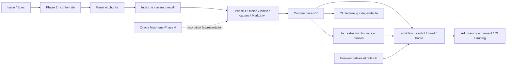

# omp-build — contrat de conception et plan de migration

> **Cadrage figé par l’opérateur : « on fige ainsi ».** Cette spécification consigne les décisions de la conversation. L’accord explicite à Q16 autorise désormais l’implémentation de T2 selon ce contrat, sans modifier une politique active, créer un ticket ou une PR, publier, activer ni appeler un modèle payant. Le terme produit **Spec** désigne toujours le corps d’issue. Ce document reste dans `artifacts/plans/`, sans inventer un second propriétaire produit.

**Suite autorisée :** T1 a qualifié le raccord natif par des sondes temporaires isolées, sans appel payant. L’accord « ok » à Q16 autorise T2 : contrat commun, adaptateur, producteurs, fix/falsification et consommateurs workflow/CI. T3–T5, campagne payante et activation gardent leurs obligations et autorisations distinctes.

## 1. Résultat recherché et limites

Un opérateur désigne explicitement un chantier par `/feature <référence>`, autorise un périmètre jusqu’au merge et laisse omp-build continuer sur les transitions connues. Il peut reprendre ce chantier depuis une autre session ou machine sous la même identité, avec omp-build, les accès et les outils requis, sans transférer un état métier local.

La reprise concerne ce qui est **publié et confirmé à distance**. Elle ne restaure ni modifications non poussées, ni raisonnement perdu, ni résultat d’agent jamais publié. GitHub conserve les records ; Git conserve code et configurations normatives. Un checkout, des caches et des fichiers temporaires restent nécessaires à l’exécution, mais ne font pas autorité pour la reprise.

Trois modules conceptuels, dans le même plugin : moteur de workflows bornés, configuration Roxabi, adaptateur GitHub. Pas de service, base supplémentaire, registre de workflows, framework universel, gestionnaire de machines, ordonnanceur d’agents ou garantie exactly-once. Un seul coordinateur actif ; passation séquentielle. L’édition ou la suppression manuelle de l’historique GitHub est un risque accepté, sans nouveau mécanisme anti-altération.

### Arbitrages validés — forme et configuration

| Décision | Contrat figé |
|---|---|
| Q1–Q2 | Graphes bornés assemblant des actions produit connues ; configuration Roxabi commune livrée avec le plugin, pas copie intégrale par dépôt. |
| Q3 | `/feature <référence>` sélectionne explicitement le chantier ; ouvrir OMP ne lance rien. Une nouvelle session ne redemande pas le mandat encore applicable. |
| Q4 | Configuration TS déclarative, sérialisable en JSON, validée par Zod ; actions/conditions nommées, aucun callback arbitraire. |
| Q5 | Paramètres techniques et exigences supplémentaires par projet ; aucun affaiblissement des invariants, admissions ou bornes communs. |
| Q6 | Objectif, périmètre, critères d’acceptation et contraintes normatifs versionnés ; changement matériel soumis à l’opérateur, rédactionnel seul non soumis, ambiguïté arrêtée. |

### Arbitrages validés — exécution et conservation

| Décision | Contrat figé |
|---|---|
| Q7 | Correction CI automatique seulement si attribuée au changement, dans le mandat et la borne existante ; nouvelle review et nouveaux checks ensuite. Pas de correction automatique d’infrastructure, d’antécédent ou de cause inconnue. |
| Q8 | Publier chaque contribution rendue, y compris incomplète/invalide/en erreur, avec ses associations et sa provenance. Pas d’archivage des transcripts complets d’outils. |
| Q9 | Même identité opératrice sur les machines ; provenance des agents distincte ; aucune délégation multi-opérateurs ajoutée. |
| Q10 | Contribution obligatoire absente/inutilisable : finir de recueillir le travail déjà engagé, conserver les résultats, arrêter avant correction automatique ou landing. Pas de nouvelle boucle métier de retry. |
| Q11 | Stop = pause durable et désarmement vérifié ; reprise explicite par la même référence. Abandon = révocation distincte. Un arrêt de borne/sécurité n’est jamais une pause contournable. |

### Arbitrages validés — persistance et prérequis

| Décision | Contrat figé |
|---|---|
| Q12 | GitHub seul pour la persistance des records. Risque d’édition/suppression accepté ; ni ancre indépendante, ni ref Git de métadonnées, ni stockage externe anti-altération. |
| Q13 | Configuration normative des preuves versionnée dans Git et liée au chantier. Fin du fallback local ignoré faisant autorité ; pas de publication aveugle de fichiers existants contenant potentiellement des secrets. |
| Q14 | Prérequis externes déclarés et vérifiés : OMP, authentification GitHub, outils projet et producteurs applicables. Absence = diagnostic/arrêt, jamais suppression du contrôle ni installation universelle. |
| Q15 | Contrat consolidé confirmé ; rédaction autorisée, implémentation et campagne native payante non autorisées. |

## 2. Exigences : origine et nature

### Besoins produit

| Exigence | Origine | Conséquence |
|---|---|---|
| Feature assistée jusqu’au merge sous autorisation initiale | [#720](https://github.com/Roxabi/roxabi-plugins/issues/720), Q3/Q6 | Pas de confirmation finale systématique ; pas d’Epic `/goal` obligatoire. |
| Reprise ailleurs sans état métier local indispensable | Demande opérateur, Q8/Q9/Q13 | Persistance des résultats et décisions utiles ; relecture des faits, pas restauration d’une session OMP. |
| Trois modules et stockage remplaçable | Demande opérateur | L’interface de records ne prend pas la forme d’un client GitHub universel. |
| Classement selon impact démontré, conservation intégrale | [#736](https://github.com/Roxabi/roxabi-plugins/issues/736) | Garder S1–S4/M1–M2 et les associations originales ; la provenance recall n’est pas un motif de blocage en soi. |

### Invariants et garanties à préserver

| Exigence | Origine | Conséquence |
|---|---|---|
| Absence, ambiguïté, référence inconnue ≠ approbation | Demande opérateur ; admission actuelle | État incomplet/refusé distinct d’un verdict approbateur. |
| Finding incomplet représentable, non réparé implicitement | Contrats actuels dev-review/fix ; Q8/Q10 | Garder le brut et le diagnostic ; jamais auto-applicable par fusion avec un autre rapport. |
| Bornes, identité, binding, preuves, CI et désarmement | #720 ; `feature/workflow.js`, `proof.ts`, CI | Les migrer, pas les remplacer par un verdict du modèle ni un booléen du store. |
| Oracle indépendant du modèle et du code qu’il vérifie | #736/#865 ; demande opérateur | Attentes hors entrée modèle ; assertions externes sur résultats et associations, pas simple round-trip. |
| Risques acceptés non promus en prérequis | Q12 ; #858/#859/#864 | Pas de durcissement supplémentaire sans incident/besoin et nouvel arbitrage. |

### Choix d’implémentation ou commodités historiques

| Choix actuel | Nature | Traitement |
|---|---|---|
| Prose Markdown, marqueurs positionnels, références par description | Protocole d’implémentation, pas besoin produit | Remplacer par IDs et records structurés ; garder la lisibilité via projection. |
| Lectures séparées dans skills, JS et jq CI | Duplication d’implémentation | Un module produit réellement utilisé par tous les chemins concernés. |
| Mémoire conversationnelle, index recall et captures locales | Commodité d’exécution | Temporaires autorisés ; conserver leurs entrées/résultats nécessaires à la reprise distante. |
| Configuration de preuve ignorée et non commise | Contrat existant non portable | Changement de contrat explicite Q13, pas simple refactor. |
| Oracle privé reconstruisant le Markdown | Tactique historique de qualification | Ne pas poursuivre sa réécriture ; reporter ses obligations pertinentes sur le nouveau chemin produit. |

## 3. Carte actuelle observée

| Chemin actuel relu | Responsabilités mélangées ou particularité |
|---|---|
| `plugins/omp-build/skills/dev-review/SKILL.md:115–163,329–378,481–514` | Spec, provenance des émissions, index recall, jugement sémantique, conservation, labels, causes et rendu dans des instructions. Recall déclenché par l’index, pas moteur de déduplication. |
| `plugins/omp-build/skills/dev-review/root-causes.md:47–90` ; `skills/fix/SKILL.md:136–168` | Identité des membres par `path:line` + description finale ; `/fix` reparcourt le Markdown et possède une entrée conversationnelle. |
| `plugins/omp-build/skills/feature/workflow.js:1536–1627,1779–1822` ; `.github/workflows/auto-merge.yml:176–207` | `reviewRecords` et lecteur jq distincts. Le lecteur workflow pagine ; `/fix` utilise encore `gh pr view --json comments`. Lire le même commentaire ne signifie pas partager le même contrat. |
| `plugins/omp-build/skills/feature/proof.ts:321–365,669–699` ; `proof-acquire.ts:188–222` | Admission et acquisition distinctes ; fallback `source: ignored` qui exige des octets locaux absents du record. Les preuves publiées restent des outputs natifs, pas seulement leurs hashes. |
| `plugins/omp-build/omp/index.ts:107–145` ; `skills/feature/epic-driver.ts:679–689` | Entrée slash injectant des instructions, pas coordinateur structuré ; review finale Epic publiée sur issue, autre consommateur à couvrir. |

Les chemins abrégés `skills/...` ci-dessus sont relatifs à `plugins/omp-build/`. Sources locales observées le 2026-10-21 ; l’existence d’un chemin n’atteste pas son exécution réussie.

**Historique, pas code actif :** `scripts/phase4-model.ts` et `scripts/__tests__/phase4-baseline.ts` sont absents du workspace courant et ont été relus au [head f92f360 de #867](https://github.com/Roxabi/roxabi-plugins/tree/f92f360cc0ae021b185cd0069cea22ad1ff801eb/scripts). Le premier exécutait un programme Phase 4 natif borné ; le second reconstruisait les identités/champs/groupes Markdown. Les trois faux verts déjà reproduits sont des défauts de qualification, pas des incidents de production/merge démontrés ; ils n’ont pas été rejoués pour ce cadrage.

**Hypothèse architecturale :** les interprétations multiples et la reconstruction inverse contribuent aux défauts récurrents. **Faits établis :** ces interprétations existent. **Non prouvé :** leur suppression suffira à réduire les erreurs sémantiques du modèle ou le temps de livraison.

## 4. Alternatives et choix

| Architecture | Gain / coût / limite | Décision |
|---|---|---|
| Markdown normalisé + parseur standard partagé | Réduit les variantes syntaxiques ; conserve une reconstruction de données depuis la présentation et ne règle pas seul le mandat/reprise. | Tactique rejetée comme chantier principal ; ne pas investir dans un oracle destiné à disparaître. |
| Records structurés + moteur borné + exécution OMP + adaptateur GH | Cutover coordonné des producteurs, consommateurs et tests ; peu de primitives nouvelles ; reprise depuis les résultats publiés. Ne garantit ni justesse sémantique ni immutabilité GH. | **Choisie.** |
| Framework général de workflows durables par-dessus OMP | Capacités plus larges, mais deuxième modèle de runtime, stockage/intégration supplémentaires et coût d’exploitation sans besoin établi. | Rejeté pour ce périmètre, pas déclaration d’incapacité de ces frameworks. |

### Stack

TypeScript strict, Bun, Zod autonome ; types inférés et JSON Schema dérivé, pas deux schémas maintenus. Ne pas supposer que `pi.zod` est la bibliothèque Zod : OMP exporte aussi un builder adossé à omptype. Schémas JSON-représentables, sans coercition, stripping silencieux ou défaut transformant une absence en succès. Les extensions de rapport restent conservées explicitement.

Versions `latest` npm relues le 2026-10-21 : **TypeScript 7.0.2 ; Zod 4.6.7 ; Bun 1.4.3 ; Vitest 5.0.5 ; Biome 2.5.15 ; OMP 18.12.5**. Recontrôler les stables à l’implémentation, tester leur compatibilité et verrouiller les versions résolues ; aucune installation effectuée ici.

Ni Effect ni Drizzle : aucune base SQL à mapper et pas de besoin justifiant un nouveau modèle de programmation. Ne pas réinventer des statecharts : si états hiérarchiques, régions parallèles, historique ou timers métier deviennent réellement nécessaires, réévaluer XState plutôt qu’étendre un DSL maison. Cette condition n’ajoute pas une dépendance maintenant.

### Réutilisation OMP

Le [tag OMP 18.12.5](https://github.com/can1357/oh-my-pi/tree/d5cd750e41fede277f9eb933455da92a0738915e) expose depuis `packages/coding-agent/src/index.ts` le SDK et `task/executor`. `runSubprocess` est un exécuteur **in-process**, malgré son nom. OMP reste propriétaire des agents, du fan-out, des attentes, de l’annulation et des ressources de session.

Un export public ne prouve pas qu’un appel direct conserve les restrictions parent→enfant, les hooks et l’admission de concurrence du dispatcher. Le bridge doit employer le chemin natif approprié et le qualifier avant activation. Le retour brut prévalidation, y compris invalide/en erreur, est une obligation distincte de la sortie structurée. Ni la session OMP, ni son goal, ni un stockage SQL/Redis de transcript ne deviennent la machine d’état métier.

**Limitation native observée, pas hypothèse :** dans l’exécuteur 18.12.5, `buildSchemaViolationOutcome` remplace des données invalides par un aperçu limité à 500 caractères (`:619–712`) ; `finalizeRunResult` peut tronquer le résultat restitué et son artifact éventuel conserve une sortie déjà transformée (`:2814–3025`). `SingleResult.output`, `structuredOutput` et `onProgress` ne suffisent donc pas à prouver Q8. T1 a exercé le canal public `pi.events.on('task:subagent:event', ...)` : les deltas `toolcall_delta` conservent les arguments originaux, même syntaxiquement invalides ; `message_end` conserve aussi le texte partiel observé lors d’une annulation. Capturer seulement les arguments déjà parsés ou les aperçus d’erreur ne suffit pas. La collecte produit devra sélectionner les contributions pertinentes et leurs tentatives, pas archiver tout le transcript.

### Raccord validé après T1 — Q16 autorise l’implémentation T2

Le SDK public examiné n’expose pas de dispatch arbitraire de `task` depuis un handler de commande. `ctx.invokeTool` délègue uniquement au built-in de même nom depuis un outil qui le redéfinit (`extensions/types.ts:780–794`) ; `runSubprocess` direct ne remplace pas le dispatcher natif.

**Choix validé :** conserver le chemin natif médié par le modèle. La commande détermine l’action admissible et sollicite l’assistant OMP ; un garde hôte contrôle la demande avant le lancement ; OMP conserve dispatch, concurrence, attente et annulation. La continuation connue utilise ses messages de suivi natifs. T1 a exercé deux actions successives depuis une seule commande, le refus d’une demande hors autorisation avant tout enfant, puis l’arrêt sur résultat strict invalide malgré une enveloppe extérieure « réussie ». Les instructions seules ne constituent pas ce garde.

« Automatique » signifie ici **sans confirmation humaine à chaque transition connue**, pas « déclenché sans tour du modèle ». Un refus, une absence d’appel ou une demande divergente ne donne aucune permission et ne garantit aucune progression ; diagnostiquer/arrêter sans boucle métier de relance. Le coût et la fiabilité de coordination avec un vrai modèle restent à mesurer. Ce choix précise le contrat d’exécution et n’est pas présenté comme un refactor neutre.

Le mode natif `blocking: true` des rôles concernés peut fournir les résultats complets attendus par une phase sans désactiver globalement `async.enabled` ; T1 a exercé ce cas positif avec async activé. OMP conserve le fan-out et son sémaphore. Cette configuration Roxabi reste à adopter explicitement ; aucun agent produit ni réglage global n’a été modifié. Une interface upstream supplémentaire n’est justifiée que si l’on exige un dispatch sans tour du modèle ou si le raccord retenu ne permet pas de préserver une protection nécessaire, pas par précaution.

## 5. Modules et interfaces cibles

| Module | Interface et responsabilité | Ne possède pas |
|---|---|---|
| **Moteur borné** | Records + faits actuels + configuration effective → état et prochaine action admissible. Validation structurelle/référentielle, conservation, comptage, calcul des groupes/verdict, projection. | Jugement sémantique, appels GitHub/SQL, scheduler, politiques inventées à la volée. |
| **Roxabi** | Configuration sérialisable des graphes, rôles, actions/conditions nommées et exigences. Implémentations des actions produit connues, raccordées à OMP au point d’entrée existant. | Callbacks dans les données de configuration, workflow copié par projet, affaiblissement des invariants communs. |
| **Adaptateur GitHub** | Lecture complète des records et métadonnées natives ; publication et confirmation ; localisation issue/PR et traduction des références opaques. | Décision métier, classification d’un finding, autorisation de patch ou merge. |

Les opérations Git/worktree, PR, checks, armement/désarmement et merge restent des actions produit concrètes, pas des méthodes CRUD du store. **Remplacer le stockage par une base ne remplace pas l’hébergement du code et sa CI.** Aucun second adaptateur de production n’est développé pour démontrer une hypothèse future.

### Interface minimale du chemin commun

| Opération | Entrée → sortie | Contrat |
|---|---|---|
| Lire | Référence de chantier → records, localisateurs, auteurs/révisions natifs et faits observés, ou refus | Pagination complète obligatoire. Réponse partielle ou erreur n’est pas un historique vide. Identité vérifiée sur les métadonnées natives, pas sur une affirmation du payload. |
| Publier | Record + identité stable d’opération → référence distante confirmée, résultat incertain ou refus | Confirmer la publication avant de déclarer un checkpoint. En cas d’accusé perdu, rechercher l’opération avant toute nouvelle émission. Aucun retry métier automatique. |
| Reconstituer / décider | Historique + faits + configuration liée → état puis action, arrêt motivé ou fin | Calcul pur ; jamais une approbation par défaut. Pas d’effet pendant le calcul, pas de remise à zéro via un nouveau `runId` sur la même PR. |
| Exécuter | Action connue + contexte autorisé → résultat original, résultat structuré éventuel et erreur éventuelle | Bridge OMP mince ; résultat recueilli avant validation produit. L’action vérifie ses préconditions actuelles avant l’effet. |
| Projeter | Record canonique + contributions référencées → Markdown | Déterministe ; aucun lecteur métier n’extrait de décision depuis ce Markdown. |

Un échec de lecture/version ou une identité divergente refuse l’admission. Un doublon confirmé de la même opération ne compte pas deux fois ; deux contenus incompatibles revendiquant la même identité produisent un conflit explicite. Cela traite les écritures incertaines ordinaires, pas les acteurs concurrents ou l’altération de l’historique.

## 6. Données et format produit

### Enveloppe commune

Chaque record porte une version de schéma, un `recordId`, un `runId`, un `operationId`, un type, ses références d’entrée et son contenu. Les références de dépôt, work item et change sont opaques hors adaptateur ; le commit candidat reste une identité Git explicite. Auteur/temps/révision effectivement observés viennent de GitHub, distincts des déclarations contenues dans un rapport.

Le chantier lie le mandat, la version normative de Spec, la configuration effective sérialisée, sa version produit et les références Git des configurations de preuve. Une mise à jour de plugin ne remplace pas silencieusement cette configuration. Version non supportée = arrêt explicite ; pas de lecture permissive ni de fallback ancien format.

### Records métier nécessaires

| Record | Contenu utile à la reprise |
|---|---|
| **Mandat / définition du chantier** | Objectif, périmètre, critères et contraintes approuvés, opérateur, configuration/version, référence Spec d’origine, permissions et exclusions, liens aux antécédents pertinents. Version normative acceptée conservée ; une modification matérielle produit une nouvelle décision d’opérateur. |
| **Étape / tentative de review** | Action connue, entrées exactes, candidat et preuves liés, roster et contributions attendues obligatoires/conditionnelles, début et résultat observé. L’inventaire est publié avant le dispatch ; les besoins recall issus de l’index sont ajoutés avant leur dispatch. |
| **Contribution originale** | Identité attribuée par l’hôte, phase/rôle/chunk/source observés, retour original complet, findings structurés lorsqu’extractibles et leurs IDs stables, associations propres evidence/callsites/extensions, erreur et diagnostic séparés. Une sortie non structurée reste un original retenu. |
| **Décision et review finale** | Jugement original du modèle ; findings finaux avec `sourceFindingIds`, label et justification d’impact ; causes avec `findingIds` et plan unique. Références aux originaux, preuves et entrées jugées. Groupes/verdict dérivés, jamais une deuxième décision libre du modèle. |
| **Résultat d’action / preuve / contrôle opérateur** | Résultat de fix et falsification, outputs natifs de preuve complets, observations CI/landing, demande de pause puis désarmement confirmé, reprise, abandon, arrêt de borne et fin. Références plutôt que recopie indépendante des mêmes informations. |

Les IDs de findings originaux sont attribués à l’émission, pas reconstruits depuis une description ou un `file:line`. Chaque finding original reste couvert par exactement un finding final ; plusieurs originaux ne peuvent être associés à un même final que par une décision explicite de fusion. Les contributions sans findings, erreurs et fragments inutilisables sont également inventoriés : zéro finding n’est pas inféré d’un échec de parsing.

### Séparation des responsabilités

| Modèle | Mécanique déterministe | Autorité d’exécution |
|---|---|---|
| Identité d’un défaut, fusion, impact, label final, causalité et plan de correction. | Conserver les originaux, valider couverture/IDs/multiplicité, contrôler les champs requis, dériver groupes/verdict et rendre. | Mandat, scope, identité, candidat, borne, preuves applicables, CI, approbations et armement existants. |

Le code ne remonte pas un label parce qu’un original était bloquant et ne rabaisse pas un label faute d’impact : ces erreurs du modèle doivent faire échouer la qualification sémantique. Un finding inutilisable reste distinct et ne récupère pas les champs d’un autre par fusion. Label connu bloquant = blocage conservé ; label absent/inconnu ou entrée obligatoire inutilisable = review inadmissible, jamais approbation ou application automatique. Une cause incomplète ne s’applique pas ; un blocker sans cause sûre reste bloquant.

Les sept éléments du plan de cause restent : mécanisme, correction, scénario d’échec, comportement restauré, chemins, preuve, membres. Les membres deviennent des IDs ; les descriptions ne servent plus de clés. Un finding appartient au plus à une cause ; une cause ne peut inclure un membre inconnu, dupliqué ou ambigu. Confidence ne sert qu’à l’ordre, jamais au filtrage ou à l’autorisation.

### Placement et transport GitHub

Mandat et décisions pré-PR sont publiés sur l’issue ; une fois la PR liée, contributions/reviews/preuves/résultats de livraison vont sur la PR. Le lien issue↔PR et le `runId` permettent la relecture de l’ensemble, sans copier l’historique de l’issue sur la PR. Les records Epic existants restent sur leur issue, avec le même codec et les mêmes règles communes applicables.

Un **record logique** est transporté dans un commentaire lorsqu’il tient, sinon dans un ensemble numéroté de commentaires. Conserver la capacité multipart existante de `feature/proof.ts:390–435`, déjà couverte par `proof.integration.test.ts:1917–1950`, et la généraliser au codec commun plutôt que maintenir l’ancien lecteur. Framing proposé : première ligne `<!-- omp-build:record kind=<type> id=<recordId> part=<i>/<n> <fragment base64url> -->`, puis la portion de Markdown générée. Le codec vérifie les identités/types/numéros, reconstitue le JSON UTF-8 et valide son schéma ; il ne parse ni titres, ni listes, ni backticks du Markdown. Le modèle ne rédige pas l’enveloppe. Ce transport n’est ni chiffrement ni garantie anti-altération.

Chaque partie respecte le plafond GitHub, enveloppe et projection comprises. Une seule publication logique produit toutes les parties de données et de présentation ; aucun modèle ne rédige une review annexe. Le checkpoint n’existe qu’après confirmation et relecture de l’ensemble complet. Un ensemble incomplet, ambigu ou contradictoire interdit l’admission ; une publication plus récente incomplète ne permet jamais de revenir à un ancien vert. Relire les parties confirmées d’une opération incertaine avant de reprendre sa publication, sans refaire le jugement modèle. Les parties d’une review ne comptent pas comme plusieurs reviews ; une tentative finale déjà partiellement publiée reste visible dans le comptage et le diagnostic.

Le record de review pointe vers les records des contributions ; sa projection montre tous les findings finaux et leurs liens de provenance, avec continuation déterministe sur plusieurs commentaires si nécessaire. Les octets originaux restent disponibles sans répétition intégrale dans la synthèse. Une taille dépassant un commentaire déclenche le multipart, pas une réduction du périmètre supporté. Un refus de publication reste explicite, sans troncature ni checkpoint distant fictif.

Pas de snapshot local autoritaire. Ordre et dépendances s’appuient sur les références explicites et les faits natifs ; les timestamps ne remplacent pas les liens d’entrée. Les contrôles actuels d’égalité des inputs et de recevabilité des preuves restent ; aucun nouveau dispositif général de détection d’édition/suppression ne leur est ajouté.

## 7. Machine d’état : ce qui est stocké et ce qui est calculé

**Stocké :** mandat/configuration liés, entrées et résultats des actions, contributions, décisions, preuves et contrôles opérateur. **Calculé à chaque reprise :** phase atteinte, entrées manquantes, binding courant, consommation de borne et prochaine action. Aucun champ mutable `currentState` ne constitue une seconde vérité.

### Progression normale

| État dérivé | Condition de sortie | Action suivante |
|---|---|---|
| À cadrer / prêt | Mandat et Spec normatifs acceptés, prérequis présents | Préparer le checkout et implémenter dans le scope. |
| À revoir | Candidat publié, inputs/proofs applicables acquis et capturés, PR désarmée | Phase 2 → panel → index/recall requis → synthèse structurée. Publication des contributions au fil des retours. |
| À corriger | Review complète non approbatrice, cause sûre applicable, borne disponible | Appliquer le plan autorisé, falsifier, publier le candidat ; nouvelle acquisition/review. |
| À admettre / attendre CI | Review approbatrice liée aux inputs actuels, preuves et contrôles requis recevables | Admission fraîche, armement conforme, attente native des checks/merge. CI rouge attribuable : correction bornée puis nouvelle review ; sinon arrêt. |
| Terminé | Merge effectivement observé et obligations de fin applicables satisfaites | Publier le résultat ; aucune nouvelle action autonome hors mandat. |

### Entrée autonome de correction

`/fix` conserve son entrée autonome : elle n’exige pas de lancer un `/feature` complet. L’action Roxabi d’entrée résout l’issue/PR cible depuis les arguments et le contexte Git/GitHub ; si un mandat applicable existe, elle le réutilise. Sinon, la commande explicite de l’opérateur autorise un **mandat limité à la correction demandée**, publié sur cette cible : aucune permission de landing n’en est déduite. Une cible absente/ambiguë ou une portée indéterminée provoque la question nécessaire, pas un ticket créé pour stocker de l’état.

La même action conserve le texte original fourni comme contribution puis appelle la synthèse structurée commune pour établir findings, causes et plan, avant toute modification. Le résultat est une décision de correction, pas une review indépendante permettant le merge. Validation, admission du plan, application et falsification empruntent ensuite le chemin commun ; le résultat et les commits poussés sont publiés. Une review déjà structurée est consommée par référence, sans reclassification. Sans PR, la fin de cette correction ne comporte ni armement ni landing ; la reprise se fait par `/fix <référence>`. Une review autonome sans PR peut emprunter cette même transition, sans imposer rétroactivement toute la Feature.

### Interruptions distinctes

| État dérivé | Déclencheur | Reprise |
|---|---|---|
| Pause demandée / pausé | Stop humain ; interruption du coordinateur, publication de la demande, désarmement puis lecture de confirmation | `/feature <même référence>` réactive explicitement le mandat encore valide. Sans confirmation du désarmement, signaler l’échec, pas « désarmé ». |
| Bloqué | Prérequis manquant, donnée requise inutilisable, inputs périmés ou scénario inconnu | Cause nommée à résoudre ; décision opérateur si nécessaire. Jamais retour silencieux au chemin heureux. |
| Arrêt définitif sur cette PR | Borne épuisée, échec CI sans correction encore permise par la borne, ou arrêt de sécurité non levable par continuation ordinaire | Dossier et éventuel remplacement explicitement autorisé ; ancienne PR toujours arrêtée et désarmée. |
| Abandonné | Révocation explicite du mandat | Aucune reprise automatique sous ce mandat. |

La borne reste celle du produit : toute review finale publiée compte ; au plus deux records permettent encore un fix ; une review non approbatrice au-delà de la deuxième épuise définitivement la borne sur cette PR. Un vert ultérieur ne la restaure pas. Contributions et refus pré-review ne sont pas des reviews finales. Une reprise de session, un nouveau commit ou `runId` ne remet aucun compteur à zéro.

Cas distinct à conserver : après une troisième review **approbatrice**, un échec CI ne permet plus de fix (`workflow.js:1742–1746`). Publier l’arrêt `ci-failed` et le dossier correspondant ; il reste opposable après reprise, même si les checks redeviennent verts. Il ne se déduit pas du seul compteur de reviews rouges. La récupération suit le contrat d’escalade de `dev-review/SKILL.md:664–684`, pas une reprise ordinaire assimilée à la pause.

Pour un effet dont le résultat est incertain, relire d’abord les faits natifs et les records de l’opération. Si son résultat ne peut être établi, arrêt explicite plutôt que répétition aveugle. Cela ne promet ni transaction entre plusieurs commentaires/labels, ni reprise d’un agent vivant sur une autre machine.

## 8. Suppression → simplification → accélération → automatisation

### Suppressions proposées et conditions de réintroduction

| Supprimer | Ce qui reste garanti | Réintroduction seulement si |
|---|---|---|
| Reconstruction des findings/causes/verdict depuis le Markdown | Conservation structurée, IDs, labels et projection humaine | Besoin réel d’import externe Markdown ; import explicite comme contribution, jamais second protocole d’admission. |
| Lecteurs métier indépendants, notamment jq CI | Même schéma et mêmes décisions déterministes dans tous les consommateurs | Environnement incompatible démontré ; préférer exposer le module commun, pas copier la règle. |
| État local indispensable, second goal/runtime/scheduler | Reprise des checkpoints GH et exécution native OMP | Limitation native constatée ; traiter la petite interface manquante, pas créer un orchestrateur concurrent. |
| Fallback de configuration normative ignorée | Configurations Git approuvées et producteurs applicables conservés | Besoin réel de configuration distante sans secrets ; nouveau contrat explicite avant développement. |
| Oracle privé de reconstruction Markdown et qualification comme autorité de produit | Assertions indépendantes du chemin produit et campagne sémantique bornée | Défaut de rendu réel nécessitant un test de présentation ; jamais restauration d’un oracle métier parallèle. |

### Simplification

Une définition de schéma, un calcul de conservation/références, une règle de verdict, un rendu et une interface de persistance. Réutiliser les calculs existants de roster, de next-step, d’admission et de preuves lorsqu’ils conviennent ; ne pas recopier leurs politiques dans la configuration et le moteur. Les adaptateurs et fixtures de test franchissent la même interface que le produit.

Les actions d’issue-triage restent propriétaires des écritures de tickets/relations. Le nouveau format n’active pas implicitement evidence-v1, les optional-neighbors, une nouvelle politique de dette, de retry ou de review différentielle. Les comportements non ciblés restent conservés ; supprimer un ancien chemin devenu sans appelant n’autorise pas à supprimer ses obligations encore applicables.

### Accélération puis automatisation

Aucun gain de latence ou coût n’est mesuré ici. Après suppression et simplification, mesurer les étapes réellement lentes ; conserver le fan-out natif déjà permis et éviter les recalculs du rendu/index à entrées inchangées, sans cache métier autoritaire. Automatiser ensuite uniquement les transitions connues du mandat. Aucune augmentation de parallélisme, budget modèle, retry ou permission de landing n’est justifiée par la seule présence d’un moteur.

## 9. Consommateurs et cutover

### Production et correction

| Surface actuelle | Migration obligatoire |
|---|---|
| `dev-review/SKILL.md`, roster, prompts de panel/spec/recall et index de classes | Produire et conserver les contributions structurées/originales ; IDs et index sans fusion déterministe ; conserver roster, caps et avertissements. |
| `dev-review/evaluation.ts`, `evidence-policy.md`, synthèse et `root-causes.md` | Garder la distinction jugement/autorité ; politique finale liée explicitement à la version du chantier ; causes par IDs ; un seul chemin actif autoritaire après cutover. |
| `fix/SKILL.md`, `fix/falsification.md`, reçus de fix/dette | Lire la review structurée, ne pas re-dédupliquer/reclasser ses membres ; plan et admission uniques, résultats conservés. Migrer aussi l’action autonome décrite au §7 : cible → mandat fix-only → contribution → décision structurée commune → application/falsification, sans permission implicite de landing. |
| `feature/workflow.js`, `workflow.d.ts`, `proof.ts`, `proof-acquire.ts` | Consommer les mêmes records ; préserver collecte fraîche, binding, preuves, borne, portes d’armement et refus ; retirer la source normative locale ignorée. |
| `feature/epic.ts`, `epic-driver.ts`, `omp/index.ts`, ci-watch et protections push/landing | Raccorder les chemins existants et records Epic ; ne pas créer un nouveau mode Epic. OMP exécute, le moteur décide depuis les faits publiés. |

### CI, documentation et tests

| Surface | Migration obligatoire |
|---|---|
| `.github/workflows/auto-merge.yml` et lecteurs/automatisations associés | Appeler le module commun, pas une traduction jq de ses règles. Charger une version de confiance approuvée, jamais le code d’admission modifiable par le candidat qu’il juge. Conserver les contrôles CI/branch et exceptions indépendantes hors de ce changement. |
| Identité locale `gh api user` et CI `OMP_BUILD_AUTOMATION_LOGIN` | Résoudre la même identité opératrice autorisée. Le compte exécutant le workflow CI n’est pas automatiquement l’auteur de review à accepter. |
| Tests dev-review `evaluation`, `roster` ; feature `openpr`, `review-start`, `armed-gate`, `land`, `proof`, Epic et hooks | Migrer les fixtures et assertions de comportement ; retirer les tests de formulation/wiring devenus sans valeur, ne pas les réépingler. Chaque test qui fork reste `.integration.test.*`. |
| Programme natif historique et paquets de qualification référents | Nouvelle entrée de qualification sur le chemin produit réel ; ne pas importer/exécuter une branche arrêtée ou un oracle historique. Garder les preuves historiques consultables. |
| README racine/plugin, GLOSSARY, docs de skills et commandes de validation | Mise à jour avec le cutover effectif : format, configuration, reprise, refus et limites. Version package/catalogue OMP synchronisée à la livraison ; cache rafraîchi par installation, pas édition seule du cache. |

### Anciens records et déploiement coordonné

Les anciens records restent consultables avec leur provenance. Le nouveau chemin ne les transforme pas automatiquement en mandat, décision structurée, approbation ou compteur nul. Une PR historique portant l’ancien protocole refuse l’admission nouvelle avec un diagnostic de format historique ; reconnaître le format pour refuser n’est pas entretenir son ancien parseur métier.

Aucune réactivation de #851/#867, aucune réinitialisation de leurs bornes. Les remplacements éventuels exigent la décision opératrice et les liens d’antécédents appropriés ; l’ancien arrêt demeure. Les autres dossiers historiques éventuellement en cours nécessitent une transition explicite ; aucune migration de données implicite ni fallback permanent.

La bascule ne se fait pas commentaire par commentaire avec deux autorités actives. Désarmer/pause des PR concernées, installer le lecteur CI commun de confiance et le plugin compatible, vérifier leurs versions/identités, puis seulement publier et activer le nouveau protocole sur le nouveau chantier autorisé. Une combinaison incompatible refuse ; elle ne relit pas un ancien vert en ignorant un nouveau record.

Retour arrière : arrêter et désarmer les nouveaux chantiers, conserver tous leurs records ; corriger en avant ou revenir à un lecteur capable du format après décision explicite. Une ancienne version incapable du nouveau protocole ne peut pas le poursuivre. Pas de conversion silencieuse de records, d’effacement d’historique ou de downgrade d’admission.

## 10. Tranches de livraison et preuves de sortie

Ces tranches sont un ordre de travail, **pas cinq déploiements partiellement actifs**. T1 est une qualification temporaire supprimée ensuite ; T2–T4 composent un cutover produit cohérent, non activé tant que producteurs et tous consommateurs ne sont pas raccordés. Aucun scaffold ou nouveau lecteur inutilisé n’est un livrable produit terminé.

| Tranche | Livrable cohérent | Preuve requise avant passage |
|---|---|---|
| **T1 — Qualifier l’interface native** | Exercice temporaire via OMP installé : contribution structurée, brut invalide/en erreur, identité, annulation et protections héritées ; choix du chemin natif étayé. | Observer les résultats et hooks/restrictions réellement conservés ; distinguer programme/producteur/transport. Absence d’interface nécessaire = limitation précise et réévaluation avant construction d’un runtime. Appels modèle seulement après autorisation distincte. |
| **T2 — Remplacer le contrat de review de bout en bout** | Module commun + adaptateur + Phase 2/panel/recall/synthèse/publication + fix/falsification, y compris entrée autonome, + lecteurs workflow et CI raccordés ensemble. | Originaux et associations conservés, références fermées, incomplet/refus explicites, multipart complet admis et incomplet refusé, même résultat observé côté CLI et gate CI ; aucune décision tirée du Markdown. |
| **T3 — Rendre le chantier reprenable** | Mandat/configuration et contrôles opérateur publiés ; graphe borné et bridge OMP raccordés aux actions existantes ; preuve portable et routes Epic existantes migrées. | Reprise en session vierge depuis records/Git seulement ; pause/reprise, abandon, borne épuisée, contribution manquante et CI rouge ; configurations applicables récupérables sans fichier ignoré local. |
| **T4 — Qualifier la sémantique et la migration** | Campagne bornée sur le vrai programme produit, assertions indépendantes et contrôles dangereux ; exercice de cutover/refus des formats incompatibles. | S1–S4/M1–M2, contrôles actual-source pertinents, tout lecteur de production couvert, aucune réactivation historique ; limites et coûts observés explicités. |
| **T5 — Activer et adopter** | Publication/version package+catalogue, installation normale, lecteur CI épinglé à une source de confiance, documentation actualisée ; chantier pilote explicitement autorisé. | **Témoin positif obligatoire avant activation générale** : sélection → reprise à froid → review/correction applicable → CI/admission → merge effectivement observé, par le chemin installé. Les démonstrations de refus sont des preuves supplémentaires, jamais son remplacement. |

Les chemins obsolètes sont retirés dans la tranche qui migre leurs derniers appelants. Pas de période indéfinie « nouveau JSON + ancienne review indépendante ». L’autorisation de code, la campagne payante et l’activation sont trois effets distincts à obtenir avant de les exécuter.

## 11. Programme de preuves

### Scénarios sémantiques conservés de #736

| Cas | Observation indépendante exigée |
|---|---|
| S1 | Recall sans impact démontré : finding visible non bloquant, provenance recall conservée, verdict `Approve with comments`. |
| S2 | Recall avec preuve complète de wrapper/caller indirect affecté : blocker conservé, `Request changes`. |
| S3 | Recall non impactant + blocker courant indépendant : les deux et leurs associations distinctes conservés, `Request changes`. |
| S4 | Test manquant/faible éligible au déclassement + défaut comportemental distinct : dernier jugement de test sans effacement du blocker comportemental, `Request changes`. |
| M1–M2 | Même défaut : M1 panel bloquant + recall non étayé ne perd pas le blocage ; M2 panel non bloquant + recall étayé gagne le blocage. Dans les deux cas, conserver chaque original et ses propres associations, `Request changes`. |

Les attentes doivent vérifier séparément M1 et M2. Leurs labels ne sont pas réparés par un `max(severity)` déterministe. Confidence, origine recall et similarité textuelle ne remplacent pas le jugement testé.

### Tests déterministes, produit et intégration

| Famille | Preuve exigée |
|---|---|
| Conservation / identité | Même locus avec défauts distincts, fusion explicite, extensions et provenances associées ; omission, ID inconnu, doublon/membre ambigu et original incomplet donnent le refus attendu sans perte. Assertions fondées sur données attendues écrites indépendamment. |
| Verdict / correction | Labels exacts, groupes dérivés, cause manquante/incomplète et blocker sans plan ; aucune application ou approbation créée par absence. Rendu testé comme présentation, jamais oracle unique de sémantique. |
| Persistance / reprise | Pagination au-delà de 100 commentaires, record dépassant 65 536 caractères, multipart complet/intercalé et incomplet/contradictoire, accusé perdu, publication impossible, arrêt entre checkpoints, même opération relue sans double comptage ; deux sessions/checkout propres d’un même chantier, sans transfert de cache/transcript. Ne pas imposer deux dépôts sandbox comme programme universel. |
| Autorité / landing | Mauvais auteur/version, mandat périmé/révoqué, head ou inputs déplacés, preuves manquantes, pause/désarmement non confirmé, troisième review rouge puis vert ; séparément, troisième review verte puis CI rouge, arrêt et reprise après CI redevenue verte. Préserver le refus dans les deux cas de borne. Couvrir aussi CI rouge hors attribution, entrée fix-only sans droit de landing et véritable point d’entrée du workflow GitHub avec sa version de confiance. |
| Preuves portables / régression | Dépôt avec et sans Semctx, assertledger conditionnel, config Git portable, fallback ignoré refusé sans suppression des obligations ; chemins existants openPR/Epic/ci-watch/hooks et stops conservés. |

Les fixtures de transport ne suffisent pas à démontrer GitHub réel : la qualification d’adoption devra publier/relire de vrais records sur une cible autorisée. Les tests ne valident pas un writer par son seul reader partagé ; ils vérifient IDs, contenu original, associations, labels, états et effets attendus indépendamment, puis exercent les mêmes interfaces produit.

### Qualification native

Le programme modèle reçoit les contributions/scénarios et les instructions du produit candidat ; **jamais les attentes de l’oracle**. Recueillir source/version du programme, fixture, schéma/configuration, runtime, provider/modèle, sortie originale, résultat structuré et erreurs observées. Un timeout, output invalide, provider en erreur ou mutant sans effet n’est pas un contrôle dangereux tué.

La campagne native reste opt-in, distincte de la suite CI ordinaire : aucun secret de modèle ni appel modèle n’est ajouté à cette CI. Le lecteur d’admission CI exécute uniquement la lecture et les décisions déterministes du module commun, sans charger un runtime agent pour juger la review.

Conserver les contrôles actual-source qui distinguent notamment la perte d’un blocage original M1 et l’incapacité d’un recall étayé à bloquer S2/M2. Adapter leur mécanisme au nouveau chemin réel, sans recopier une version « dangereuse » artificielle du produit. Aucun vote, retry discrétionnaire ou accroissement automatique de budget pour obtenir un vert. Les paramètres et limites de la nouvelle campagne doivent être déclarés avant l’autorisation des appels : l’ancien programme #865 n’est pas réputé inchangé par le nouveau format.

### Preuves obtenues et non obtenues à cette étape

**Observé :** sources produit et lecteurs indépendants relus ; sources historiques à f92f360 relues sans exécution ; routes et versions natives actuelles identifiées ; versions npm consultées. Le smoke RPC antérieur sur OMP 18.12.4 ne couvrait que initialisation/lectures d’état sans appel modèle : il ne prouve pas le dispatcher 18.12.5, la publication ou la reprise.

### Résultats T1 locaux — OMP 18.12.5

Exécution du binaire installé, avec fournisseur HTTP/SSE déterministe sur localhost, HOME/configurations isolés et aucune clé de modèle réelle. **Zéro appel payant ; aucun code produit, ticket, PR, branche ou politique active modifié.** Ce fournisseur constitue une sonde de transport/runtime, pas un modèle dont on aurait qualifié le jugement. Les défauts de fixture rencontrés ont été corrigés avant de retenir les observations correspondantes.

| Chemin exercé | Observation retenue | Limite |
|---|---|---|
| Conservation | Contribution JSON de 880 049 octets conservée exactement malgré le retour final tronqué ; six soumissions JSON malformées de 1 842 octets chacune conservées via leurs deltas bruts. | Ne prouve pas encore la publication multipart GitHub ni tous les transports de modèles. |
| Protections natives | Hook parent bloquant effectivement un `write` enfant ; `write` indisponible pour scout ; `task` indisponible à la profondeur configurée ; au plus un enfant actif avec `maxConcurrency: 1`, mesuré sur le cycle de vie. | Pas une certification de toutes les approbations, isolations ou configurations OMP. Les requêtes de prefill ne sont pas des admissions de tâche. |
| Annulation RPC | Original déjà reçu conservé ; texte partiel de l’enfant actif conservé avec `stopReason: aborted` ; enfant suivant non admis ; session terminée normalement sans kill forcé. | La fermeture TCP côté fournisseur n’a pas été observée séparément. |
| Commande → garde → tâche → suite | Une commande réelle, deux actions successives automatiques ; demande divergente refusée avant tout enfant ; enfant strict invalide arrête le raccord malgré `task.isError: false`. Variante positive avec agent `blocking: true` et async activé. | Qualification d’un raccord avec états fixes de fixture, pas moteur produit, mandat durable ou reprise distante. |
| Streaming du parent | Arguments complets transmis puis fin de réponse retenue 300 ms : aucun nouveau démarrage anticipé dans ces fenêtres ; garde observé avant chaque enfant admis ; demande divergente toujours sans enfant. | La branche d’exécution spéculative active n’a pas été démontrée. Ne pas transformer cette observation bornée en garantie universelle. |

**Lecture du résultat obligatoire :** le quatrième `yield` hors schéma observé retourne un succès local avec `schemaOverridden: true`, mais le résultat strict final de l’enfant est bien `exitCode: 1`, `structuredOutput.status: invalid`. L’enveloppe `task` peut rester `isError: false`, et le processus racine retourner `0`. Le raccord doit contrôler **chaque enfant obligatoire inventorié**, son identité, son résultat final et la validation produit ; aucun de ces succès extérieurs n’est une approbation. Les quatre soumissions hors schéma et six JSON invalides observés sont des répétitions natives à conserver et rattacher à l’opération, pas des plafonds universels ni des reviews supplémentaires.

La commande lancée en `--print` s’est terminée localement sans exécuter le tour mis en attente ; le témoin de commande et continuation utilise donc une session RPC native persistante. Ne pas revendiquer le support de cette route non interactive sans le qualifier séparément. Aucune nouvelle boucle de retry métier ni contournement par exécuteur direct n’a été ajouté.

Preuves détaillées de session, assertions, identités des runs et empreintes : [capsule T1](local://omp-build-t1-evidence.json). Les sondes sont temporaires ; ce lien de session n’est ni une publication GitHub ni un checkpoint métier portable.

**Toujours à prouver sur le produit :** capture et autorisation raccordées aux vraies actions, compatibilité Zod/JSON Schema/OMP, reprise froide depuis GitHub, équivalence des lecteurs produit/CI, sûreté du cutover, autres modes natifs retenus et six cas sémantiques. Aucun test end-to-end d’omp-build ni jugement de modèle réel n’est revendiqué. Aucun contexte `.semctx/` local trouvé aux racines du dépôt/plugin ; cela ne retire pas le support Semctx des dépôts utilisateurs.

**Protocole payant :** aucune dépense supplémentaire n’est nécessaire pour conclure cette qualification locale. La campagne sémantique de T4 reste séparée : figer d’abord le commit/programme produit, les six scénarios et contrôles actual-source, le provider/modèle, les limites d’appels/tokens/durée et le plafond financier ; garder les attentes hors entrée du modèle ; conserver toutes les tentatives et arrêter sur borne sans retry discrétionnaire. Soumettre ces paramètres effectifs à l’opérateur avant le premier appel. Une sortie de la sonde synthétique n’est pas un vert sémantique et n’autorise pas cette campagne.

## 12. Critères de rejet et repositionnement historique

Rejeter ou revoir la proposition avant activation si l’un de ces constats demeure :

1. Un lecteur actif reconstruit encore findings/causes/verdict depuis le Markdown, ou un humain/modèle rédige indépendamment une seconde review autoritaire.
2. La reprise exige un état métier local non publié, perd une contribution/provenance, ou remet à zéro un arrêt/compteur en changeant de session/run.
3. Le module commun n’est utilisé que par des tests, le gate CI garde sa propre interprétation, ou une validation mécanique corrige les mauvaises classifications du modèle.
4. Le moteur doit posséder queues, agents, retries, transcripts ou sémantique générale de statecharts déjà fournis par OMP, sans limitation réelle démontrée justifiant une nouvelle décision.
5. Le cutover conserve durablement deux protocoles, étend les permissions/politiques hors des arbitrages, ou ajoute une infrastructure préventive plus coûteuse que la correction ponctuelle sans besoin observé.

**Mesure de simplification :** comparer avant/après les lecteurs indépendants, points de décision de labels/verdict, sources normatives et états locaux indispensables ; la cible est une définition partagée pour chaque règle et zéro état métier local indispensable, pas un quota arbitraire de lignes supprimées. Mesurer séparément l’effet réel sur erreurs/coût/latence, sans le présumer.

| Référence | Position dans ce plan |
|---|---|
| [#720](https://github.com/Roxabi/roxabi-plugins/issues/720) | Objectif produit conservé ; ce document ne prétend pas livrer toutes ses autres feuilles ni modifier son backlog. |
| [#736](https://github.com/Roxabi/roxabi-plugins/issues/736) | Implémentation historique close ; exigences d’impact/conservation et six scénarios deviennent critères du nouveau chantier, pas nouvelle correction de son ancien patch. |
| [#865](https://github.com/Roxabi/roxabi-plugins/issues/865) | Préalable historique clos. Conserver les enseignements d’exécution/oracle et remplacer le programme explicitement ; pas réparer son parseur ni en faire un préalable artificiel au nouveau contrat. |
| [#867 / contre-revue](https://github.com/Roxabi/roxabi-plugins/pull/867#issuecomment-6291364123) ; [dossier](https://github.com/Roxabi/roxabi-plugins/pull/867#issuecomment-6291405958) | Head historique f92f360, troisième rouge et borne épuisée ; arrêt/désarmement maintenus. Aucun contournement par réinitialisation ou fusion. |
| #858 / #859 / #864 | Risques déjà acceptés ; aucune réintroduction automatique dans le chemin critique. |

## 13. Autorisations restant distinctes

Le **choix d’architecture et l’implémentation T2 sont autorisés**, pas les résultats de qualification ni les effets externes. L’accord à Q16 couvre le raccord natif médié et le cutover source T2, sans publication ni activation. Avant les appels natifs payants, présenter le programme, ses limites et sa cible et obtenir l’accord correspondant. Avant activation, présenter les preuves obtenues, les écarts éventuels et le cutover concret. Aucun ticket, PR ou politique active n’est créé ou modifié par cette autorisation.

### Sources complémentaires

[Glossaire actuel](../../plugins/omp-build/GLOSSARY.md) · [dev-review](../../plugins/omp-build/skills/dev-review/SKILL.md) · [fix](../../plugins/omp-build/skills/fix/SKILL.md) · [feature](../../plugins/omp-build/skills/feature/SKILL.md) · [workflow](../../plugins/omp-build/skills/feature/workflow.js) · [proof](../../plugins/omp-build/skills/feature/proof.ts) · [gate CI](../../.github/workflows/auto-merge.yml).

[Zod → JSON Schema](https://zod.dev/json-schema) · [OMP exports 18.12.5](https://github.com/can1357/oh-my-pi/blob/d5cd750e41fede277f9eb933455da92a0738915e/packages/coding-agent/src/index.ts) · [OMP executor 18.12.5](https://github.com/can1357/oh-my-pi/blob/d5cd750e41fede277f9eb933455da92a0738915e/packages/coding-agent/src/task/executor.ts).

Sources des versions stables : npm `/-/package/{typescript,zod,bun,vitest,@biomejs%2Fbiome,@oh-my-pi%2Fpi-coding-agent}/dist-tags`, consultées le 2026-10-21. Ces versions sont un relevé, pas une installation ou une certification de compatibilité.
